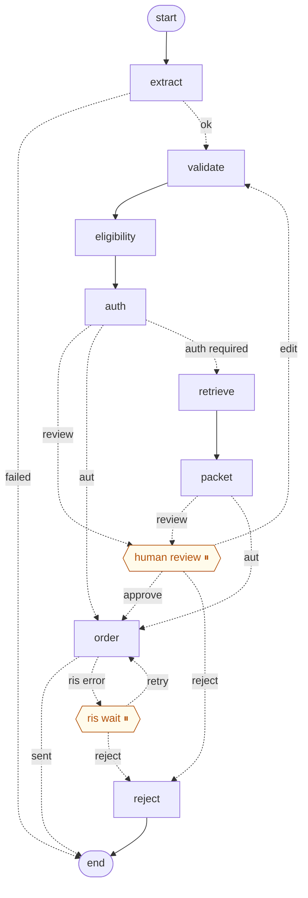

# Referral Intake

A diagnostic imaging clinic receives 30–60 referrals a day, mostly by fax. For each one, a coordinator:
1. reads a 200-dpi black-and-white scan;
2. types the demographics into the practice system;
3. verifies insurance;
4. works out whether the study needs prior authorization and assembles the packet;
5. creates the order in the RIS.

This project automates that path with a LangGraph pipeline. The pipeline **pauses for a human** whenever the model is unsure or a rule fails, and resumes when the reviewer approves, edits or rejects in the UI.

> **All data is synthetic.** Every patient, provider, NPI, payor, member ID and clinical detail is fabricated. NPIs pass the checksum but are not issued numbers, and the payors are fictional. No real patient information is used anywhere.

This README is the source of truth for the project. Every number below comes from a committed artifact, cited next to it. The repo-root `README.md` is only a pointer here.

---

## Demo in 90 seconds

Recorded by Playwright: [`docs/gates/demo.webm`](../docs/gates/demo.webm). The script is `web/e2e/demo.spec.ts`; screenshots of every screen are in [`docs/gates/screens/`](../docs/gates/screens/).

1. **Upload a fax** (`referral_013.pdf`) from the queue. The app opens the **Pipeline graph**.
2. **The nodes light up:**
   - `extract` pulses while the recorded Claude extraction replays at its real speed (~10 s);
   - then `validate` → `eligibility` → `auth` → `retrieve` → `packet`.
3. **The graph pauses at `human_review`.**
   - Coverage is not found, and prior auth is missing `prior_imaging`.
   - The model also misread the patient's first name: the page says *Clara*, the model said *Ciara*, at 0.95 confidence.
4. **Fix & resume.** In the referral detail, edit the first name to `Clara` and save. The graph resumes, re-validates and pauses again; a human must approve.
5. **Approve.** The graph resumes into `order` and sends an HL7 `ORM^O01` over MLLP. The mock RIS answers `MSA|AA`, and the ACK shows on the detail page.
6. **Evals.** v1 vs v2 on the same 60 faxes, read at runtime from `evals/benchmark_v1_v2.json`.

## Run the demo

```bash
cd referral-intake
make demo          # fresh clone -> running app with 57 seeded referrals; prints the URL
make demo-stop     # stops everything, including the demo Postgres
```

**What `make demo` does:**
1. Creates `.venv` and runs `pip install -e '.[dev]'`.
2. Runs `npm ci` in `web/`.
3. Starts a project-local Postgres with pgvector, TCP-only on `127.0.0.1:55432`, data in `.demo/`.
4. Bootstraps: tables, the policy index, LangGraph checkpoint tables.
5. Generates the corpus.
6. Starts the RIS (:2575), the API (:8000, `PIPELINE=graph EXTRACTOR=replay`) and the web UI (:5173).
7. Seeds a realistic mix: auto-approved and sent; needs review; rejected; an RIS `AE` rejection; and an RIS-down error you can retry from the Orders screen.

**Prerequisites:** Python 3.12+, Node 20+, `tesseract`, `poppler`, and the PostgreSQL 16 server binaries with the `pgvector` extension (macOS: `brew install postgresql@16 pgvector tesseract poppler`). Docker is not needed; `docker-compose.yml` (Postgres only) is an untested alternative.

**Busy ports:** `make demo DEMO_ARGS="--api-port 8090 --web-port 5190"` (also `--ris-port`, `--pg-port`). `DEMO_ARGS=--keep-going` runs every step and lists every failure.

**No API key is needed.** `EXTRACTOR=replay` serves the committed real Claude run (`evals/extraction_eval.json`): genuine predictions, confidences and mistakes, with boxes from the corpus generator. It only knows the 60 corpus faxes. For anything else, set `EXTRACTOR=claude` and `ANTHROPIC_API_KEY`.

**Tests:** `make test`, which runs pytest against the demo Postgres. Or `TEST_DATABASE_URL=postgresql+psycopg://…/postgres pytest`.

---

## Architecture

### The served pipeline (v2): `graph/`
The diagram below is generated from the compiled LangGraph by `python -m scripts.graph_mermaid` (`graph.service.structure()`). The UI draws the same structure at runtime from `GET /graph/structure`.



- **Human in the loop.** `human_review` calls LangGraph's `interrupt()`. Graph state is checkpointed in Postgres (`langgraph-checkpoint-postgres`), with thread id = referral id. The API resumes it with `Command(resume=…)` when the reviewer acts:
  - **edit** loops back through `validate` and pauses again;
  - **approve** goes to `order`;
  - **reject** ends the run.
- **The gate.** A referral auto-approves only when `app/gate.py` finds no reason to stop:
  - no validation flags at the 0.85 confidence threshold;
  - active coverage;
  - no missing prior-auth elements.
- **Sending.** `order` really sends the ORM over MLLP and records the ACK. On an `AE`, `AR` or connection failure it pauses at `ris_wait`, and *Retry send* resumes it.
- **Tracing is our own:** one `trace_events` row when each node starts and one when it ends, with duration, cost, attempt, the branch taken and the input/output state diff. There is no LangSmith or LangChain-hosted service; LangGraph runs locally.

### The baseline (v1): `app/pipeline.py`
The original linear pipeline is kept unchanged as the benchmark baseline. `PIPELINE=v1` serves it through `app/runner_v1.py`, under the same API, statuses and gate.

### Components

| Stage | Module |
|---|---|
| Corpus | `corpus/generate_faxes.py`: 60 synthetic referral PDFs from 3 form layouts, degraded to look faxed. Writes ground truth with the box each value was drawn in. See `evals/GT_NOTES.md` |
| Extraction | `app/extract.py` dispatches to `claude` (Claude vision, boxes via `app/locate.py` + local Tesseract), `replay` (the committed Claude run) or `fixture` (ground truth, invented confidences; UI work only) |
| Validation | `app/validate.py`: NPI checksum, CPT catalog, CPT↔study coherence, laterality, ICD-10 support, member-ID formats, confidence |
| Eligibility | `app/edi.py` + `app/payor.py`: hand-built X12 270 → mock payor → 271 parsed |
| Prior auth | `app/auth_packet.py` (payor rules + packet PDF), `app/rag.py` + `app/vectorstore.py` (3-step hybrid RAG on pgvector over 24 synthetic policy docs). `app/policy.py` keeps v1's keyword retrieval for the comparison |
| Order out | `app/hl7.py` (ORM^O01 + MLLP client) → `ris/server.py` (mock RIS, ACK `AA`/`AE`) |
| API | `app/main.py` + `app/api/`: FastAPI. Contract: `app/contracts.py`, documented in `../docs/CONTRACTS.md` |
| Persistence | Postgres `faxtract`: `app/store.py` (referrals, corrections, sends), `app/trace.py`, the LangGraph checkpoints, `policy_chunks`. `DATABASE_URL` is required; there is no default |
| UI | `web/`: React 19 + Vite + TanStack Table/Query + react-pdf + React Flow + Radix (shadcn-style). Design tokens in `web/DESIGN.md` |
| MCP | `ris/mcp_server.py`: five tools over the RIS order store (`search_patient`, `get_orders`, `get_order`, `create_order`, `update_coverage`) |
| Evals | `evals/run_extraction_eval.py` (keyed extraction eval), `evals/benchmark.py` (v1 vs v2), `evals/report.html` |

**The UI screens:**
1. **Queue:** filter, sort, `j`/`k`/Enter, upload.
2. **Referral detail:**
   - fax with field boxes;
   - inline edit with validation errors;
   - 270/271;
   - policy citations;
   - **Compare v1 vs v2** retrieval, side by side;
   - packet preview;
   - ORM + ACK;
   - Approve / Edit / Reject.
3. **Pipeline graph:** live node states, the path taken, a per-node state diff, and *Fix & resume*.
4. **Evals.**
5. **RIS orders:** ACK status and retry.

---

## Results

### Extraction: one real Claude run over the 60 faxes
**Source:** `evals/extraction_eval.json`.
- **Engine:** `claude`. The model (`claude-sonnet-4-6`, `app/extract_claude.MODEL`) is not recorded in this older artifact; new runs record `model` and `run_at`.
- **Committed:** 2026-08-30 (git).
- **Scoring:** against the ground truth as it was then (pre-fix, see below).

| Metric | Result |
|---|---|
| Overall field accuracy | **95.7%** (1091 / 1140 fields) |
| Fields at 100% | **13 of 19**, including CPT, ICD-10, member ID, DOB, last name, NPI and payor (60/60 each) |
| Cost | **$0.0145 per referral**: $0.8724 for 60, from 129,227 input + 32,315 output tokens at $3 / $15 per Mtok |
| Latency per fax | **p50 10.3 s, p95 12.8 s** (mean 10.6 s) |

**The six fields below 100%, explained miss by miss:**

| Field | Score | What happened |
|---|---|---|
| `patient_first_name` | 59/60 | referral_013: the page prints **Clara**; the model read **Ciara** at 0.95 confidence. This is the only true model misread of a name. |
| `referring_provider_name` | 59/60 | referral_035: the model dropped the printed ", MD". |
| `urgency` | 58/60 | referral_033 and 057: the form says ROUTINE, but a handwritten margin note says "urgent – see notes". The model went with the note. |
| `laterality` | 58/60 | referral_040 and 058: the old generator printed "n/a" for *Diagnostic mammography bilateral*. The model answered "bilateral". This is a ground-truth defect, now fixed. |
| `clinical_indication` | 57/60 | referral_004, 013 and 058: the text runs off the page edge on template_b. The model returned exactly what was printed. Known generator defect, documented. |
| `patient_address` | 20/60 | Only template_a prints an address, but the old truth had one for all 60. The model correctly returned nothing on the other 40. Under the fixed truth this is 60/60. |

### v1 vs v2: same 60 faxes, same extraction, same gate
**Source:** `evals/benchmark_v1_v2.json`, rendered as [`evals/benchmark_v1_v2.md`](evals/benchmark_v1_v2.md) by `python -m evals.benchmark`. Extraction is `replay`, threshold 0.85, truth version `as_printed`.

| | v1 (`app/pipeline.py`) | v2 (served graph) |
|---|---|---|
| Retriever | keyword overlap, whole documents | 3-step hybrid RAG on pgvector |
| Retrieval Hit@1, with CPT | 57/60 (95%) | **60/60 (100%)** |
| Retrieval Hit@1, CPT removed | 48/60 (80%) | **55/60 (92%)** |
| Auto-approved at 0.85 | 19/60 | 19/60 |
| False approvals | 1 (referral_040) | 1 (referral_040) |
| Pipeline latency p50 / p95 (no human, replayed extraction) | 0.4 / 4.1 ms | 56.8 / 122.2 ms |
| Recorded extraction latency p50 / p95 | 10.3 / 12.8 s | 10.3 / 12.8 s |
| Cost per referral | $0.0145 | $0.0145 |

- **Same decisions.** Both pipelines use the same gate and make the same auto-approve decision on all 60 referrals, so the comparison isolates orchestration and retrieval.
- **What v2's extra ~55 ms buys:**
  - pausable, resumable, inspectable runs, through a Postgres checkpoint after every step and two trace rows per node;
  - the RAG step;
  - a prior-auth packet that v1 never produces.

  Next to the ~10 s model call, that cost is noise.
- **Per-node timings** are in the `.md`.

### False-approval analysis
A **false approval** is a referral the gate auto-approved even though at least one critical field is wrong. The critical fields are first and last name, DOB, CPT, laterality, ICD-10, member ID and payor (`evals/scoring.CRITICAL_FIELDS`).

- **With the full gate there is exactly one: referral_040,** in both pipelines.
  - The model read laterality as "bilateral" at 0.99 confidence on a page that printed "n/a".
  - CPT 77066 doesn't require a side, coverage was active, and no prior auth was needed, so nothing stopped it.
  - The printed "n/a" was the generator's defect: a bilateral mammogram can't be "n/a". The fixed corpus prints "bilateral", so this case should disappear on re-extraction (NEEDS KEYS).
- **Why the README used to say 3.** That number came from `validate()` alone, which auto-approves 59/60 and falsely approves 013, 040 and 058. The full gate (validation + eligibility + prior-auth elements) holds 013 and 058, but for coverage and prior-auth reasons, **not** because it noticed the wrong name or side.
  - The honest conclusion: the confidence threshold barely filters (the model is confidently wrong on 013 and 040).
  - The safety comes from the human review that coverage and prior-auth rules force. A field-level verifier is the obvious next step.
- **Under the pure post-fix truth** the count is 4. Those 4 are stale replays of reprinted pages, scored against values those pages never showed. The benchmark reports all three truth versions.

### Ground truth: what was fixed (`evals/GT_NOTES.md`, `evals/gt_changes.json`)
- **Laterality** now follows the study and the ICD-10 codes (10 faxes reprinted).
- **Addresses** are in the truth only when printed (40 values set to null).
- **Box recording** was rewritten: 34 boxes on 31 faxes had landed on the wrong text.
- **The random-number stream is preserved:** 1,270 other values are byte-identical, and 50 pages are pixel-identical (tested).
- **Re-running the keyed extraction** on the fixed corpus (about $0.87) is **NEEDS KEYS**.

### Where each number comes from

| Number | Artifact |
|---|---|
| 95.7%, 13/19, per-field scores and misses, $0.0145, $0.8724, tokens, 10.3 / 12.8 / 10.6 s | `evals/extraction_eval.json` |
| Hit@1, auto-approved, false approvals, pipeline latency, per-node timings, the "3 vs 1" analysis | `evals/benchmark_v1_v2.json` (+ `.md`) |
| GT defects, 45 changed files, 1,270 identical values, 50 identical pages | `evals/GT_NOTES.md`, `evals/gt_changes.json`, `tests/test_corpus_truth.py` |
| 57 seeded referrals and their mix | `scripts/seed_demo.py` output at `make demo` (not a committed number) |

---

## Configuration
`.env.example` lists exactly the variables the code reads:
- `DATABASE_URL` (required)
- `PIPELINE` (`graph` or `v1`)
- `EXTRACTOR` (`claude`, `replay` or `fixture`)
- `ANTHROPIC_API_KEY`
- `CONFIDENCE_THRESHOLD`
- `RIS_MLLP_HOST` / `RIS_MLLP_PORT`
- `RIS_STORE_PATH`
- `RIS_FAULT_LAST_NAMES` (demo: makes the mock RIS answer `AE`)
- `REPLAY_PACE_S`
- `UPLOADS_DIR`
- `POPPLER_PATH`
- `HF_HUB_OFFLINE`

The eval runners refuse to run without a key, never overwrite a committed artifact with a failed run, and log the cost of every run to `evals/cost_log.jsonl`.

**MCP server:** `RIS_STORE_PATH=.demo/ris_orders.json python ris/mcp_server.py` speaks MCP over stdio to the same order store the RIS writes.

## Layout
```
referral-intake/
  app/        API (main.py, api/), contracts, store, extraction engines, validation, X12, HL7/MLLP,
              prior auth + RAG, trace, gate; pipeline.py = v1 baseline, runner_v1.py serves it
  graph/      v2: the served LangGraph (pipeline.py), service.py (runner, checkpointer, structure)
  ris/        mock RIS (MLLP server, order store) + MCP server
  corpus/     generator, fixtures, 24 synthetic policy docs; out/ is generated (gitignored)
  evals/      extraction eval, v1-vs-v2 benchmark, GT notes, committed artifacts
  scripts/    bootstrap, index, seed, demo runner, graph_mermaid
  tests/      pytest (DB tests use TEST_DATABASE_URL)
  web/        the review UI (see web/DESIGN.md); e2e/ = Playwright demo + screens
  docs/       background explainers (pgvector-migration.md is historical)
```

## Non-goals
Auth and users, multi-tenancy, real payor portals or clearinghouses, scheduling, telephony, real EHR/RIS integration, and deployment.

## NEEDS KEYS
- A keyed re-extraction of the fixed corpus with `EXTRACTOR=claude` (~$0.87).
- `rag.extract_keywords_llm`, an optional LLM step-2 for the RAG.
- Driving the MCP server from a Claude session.
